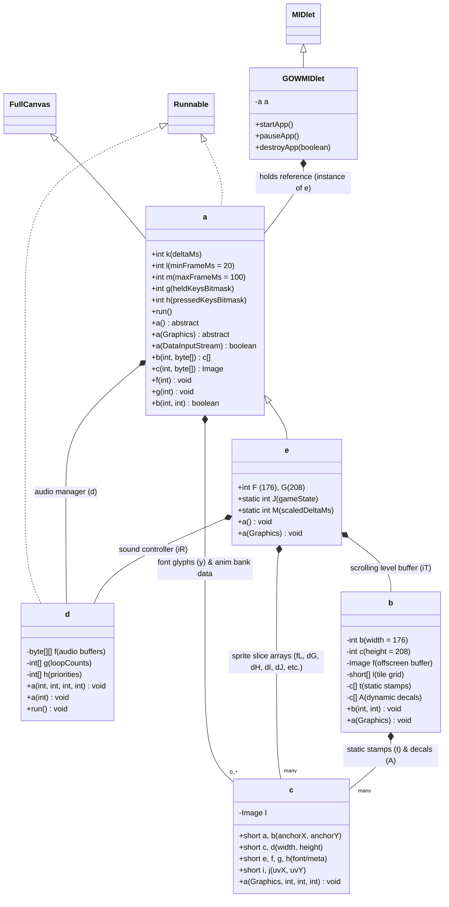
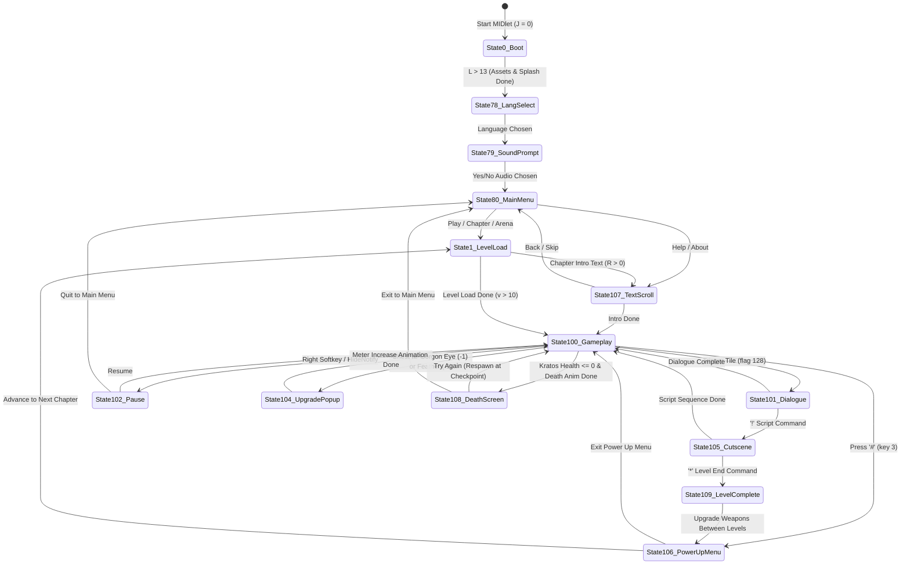

# God of War: Betrayal (2007 J2ME) — Original Architecture & Engine Analysis

## 1. Overview & Runtime Environment

**God of War: Betrayal** (`v1.4.58`, developed by WayForward Technologies / Javaground and published by Sony Pictures Mobile / Sony Online Entertainment in 2007) is a J2ME (MIDP-2.0 / CLDC-1.1) 2D side-scrolling action-platformer built on the **JavagroundJG** engine framework with Nokia UI API (`com.nokia.mid.ui.FullCanvas`, `com.nokia.mid.ui.DirectUtils`, `com.nokia.mid.sound.Sound`) and JSR-135 Mobile Media API (`javax.microedition.media`).

The decompiled codebase consists of **6 Java classes** (~336 KB of source code across ~11,096 lines) and **31 `RP*` binary resource pack files** (`RP1`–`RP10`, `RP12`–`RP30`, `RP32`–`RP33`) plus the application icon (`i.png`) and manifest (`META-INF/MANIFEST.MF`).

| Source File | Lines | Size | Obfuscated Name | Architectural Role |
| :--- | ---: | ---: | :--- | :--- |
| [`GOWMIDlet.java`](file:///c:/Users/Intel/Downloads/GOW/god_of_war/GOWMIDlet.java) | 23 | 469 B | `GOWMIDlet` | J2ME `MIDlet` lifecycle entry point (`startApp`, `pauseApp`, `destroyApp`). Instantiates `e` and attaches it to `Display`. |
| [`a.java`](file:///c:/Users/Intel/Downloads/GOW/god_of_war/a.java) | 1,519 | 38,760 B | `a` | Abstract engine base class (`extends FullCanvas implements Runnable`). Handles the main thread loop, frame timing, input bitmasks, RMS persistence, `RP*` pack loading, PNG palette swapping, bitmap font rendering, string table decoding, and hierarchical skeletal/frame animation playback. |
| [`b.java`](file:///c:/Users/Intel/Downloads/GOW/god_of_war/b.java) | 503 | 13,305 B | `b` | Offscreen scrolling background renderer. Maintains a `176×208` circular/toroidal offscreen `Image` buffer (`f`) that renders a `16×16` tilemap layer (`l`), sorted static background stamp sprites (`t`), and persistent decal/corpse stamps (`A`). |
| [`c.java`](file:///c:/Users/Intel/Downloads/GOW/god_of_war/c.java) | 79 | 2,205 B | `c` | Atlas sprite slice (`Image` region + anchor offsets + UV coordinates + dimensions + kerning/baseline metadata) with hardware-accelerated Nokia `DirectGraphics` flip/mirror support (`0`, `8192`, `16384`, `24576`). |
| [`d.java`](file:///c:/Users/Intel/Downloads/GOW/god_of_war/d.java) | 245 | 5,817 B | `d` | Dedicated audio manager (`implements Runnable`). Manages 12 sound slots, priority arbitration, loop counts, and playback via JSR-135 `Manager.createPlayer` (MIDI/WAV) or Nokia `Sound` (OTT tones). |
| [`e.java`](file:///c:/Users/Intel/Downloads/GOW/god_of_war/e.java) | 8,727 | 276,061 B | `e` | Concrete game implementation (`extends a`). Contains the state machine, level bitstream decoder, camera system, tile collision engine, Kratos movement/combat state machine, QTE manager, enemy AI & boss controllers, orb/particle physics, HUD, menus, and procedural fire effect. |

---

## 2. Class Hierarchy & Component Relationships

---

## 3. Display, Viewport & Coordinate System

### 3.1 Native Resolution & Aspect Ratio
- **Target Screen Dimensions**: `176 × 208` pixels (standard Nokia Series 60 / N-Gage / S60v2 resolution, aspect ratio `11:13` ≈ `0.846`).
  - Configured in [`a.java`](file:///c:/Users/Intel/Downloads/GOW/god_of_war/a.java#L1515-L1518) constructor (`this.c(176, 208)`) and [`e.java`](file:///c:/Users/Intel/Downloads/GOW/god_of_war/e.java#L636) (`this.F = 176; this.G = 208; H = 88; I = 104`).
- **Active Gameplay Viewport vs. Softkey Bar**:
  - During active gameplay (`J == 100`) when no cinematic letterbox bars (`U == 0`) or HUD text changes (`!iF`) are active, [`e.a(Graphics)`](file:///c:/Users/Intel/Downloads/GOW/god_of_war/e.java#L2090-L2095) clips the world render to `0, 0, 176, 194` (194 pixels tall) and reserves the bottom **14 pixels** (`y = 194..207`) for the black/gold bottom bar (`a(Graphics, int, int)` at lines 8222–8285), which displays softkey labels (`Weapon` on left, `Menu` on right), combo hit counters (`"X Hits"`), soul door sacrifice counters (`"X left"`), or Arena kill count (`"Kills: X"`).
- **Cinematic Letterboxing (`U`, `V`, `ab`, `ac`)**:
  - Transitions, cutscenes (`J == 105`), dialogues (`J == 101`), pause (`J == 102`), death (`J == 108`), and level-clear screens (`J == 109`) animate top and bottom letterbox shutters using fixed-point `24.8` variables `U` (current top bar height `<< 8`) and `V` (current bottom bar height `<< 8`) towards targets `ab` and `ac` at speed `ad = 35`, `ae = 35` ([`e.a(int, int, int, int)`](file:///c:/Users/Intel/Downloads/GOW/god_of_war/e.java#L1015-L1031) and [`e.c(Graphics)`](file:///c:/Users/Intel/Downloads/GOW/god_of_war/e.java#L2223-L2310)).
  - Closing the shutters all the way to `I = 104` (`U == 104 << 8`, `V == 104 << 8`) creates a full-screen wipe transition with a `W = 375 ms` hold timer and triggers sound slot `1` (door/shutter slam WAV `1064`).

---

## 4. Game Loop & Timing Architecture

The main loop lives in [`a.run()`](file:///c:/Users/Intel/Downloads/GOW/god_of_war/a.java#L1426-L1513):

1. **Delta Time Measurement (`super.k`)**:
   - Measures elapsed wall-clock time `var3 = (int)(var1 - this.o)` in milliseconds.
   - Clamps maximum delta to `this.m = 100` ms (10 FPS floor to prevent physics tunneling on lag spikes).
   - Enforces minimum frame time `this.l = 20` ms (configured in [`e.java`](file:///c:/Users/Intel/Downloads/GOW/god_of_war/e.java#L634-L635)). If the frame finishes faster than `20` ms, sleeps for `max(10, 20 - k)` ms and sets `this.k = 20`.
2. **Post-Update Sleep & Repaint**:
   - Calls `this.a()` (game logic update in `e.a()`) and `this.d.run()` (audio thread dispatcher).
   - Sleeps an additional `20L` ms (`Thread.sleep(20L)` at line 1473) before triggering synchronous `repaint()` + `serviceRepaints()`.
   - Because of the `l = 20` ms floor plus the unconditional `20` ms sleep, the effective frame delta `super.k` on fast devices is **~25–40 ms per tick (~25–40 FPS)**, and all animations, timers, camera interpolation, and orb velocities are driven by **`M = super.k >> this.hL`** (milliseconds elapsed).
   - Notice `this.hL`: during QTE prompts (`fV == true`), `this.hL = 1`, which **halves `M` (`super.k >> 1`)**, creating a **50% slow-motion effect**!

---

## 5. Game State Machine (`e.J`)

The static integer [`e.J`](file:///c:/Users/Intel/Downloads/GOW/god_of_war/e.java#L31) controls the top-level game state in both [`e.a()`](file:///c:/Users/Intel/Downloads/GOW/god_of_war/e.java#L706-L1013) (update) and [`e.a(Graphics)`](file:///c:/Users/Intel/Downloads/GOW/god_of_war/e.java#L2026-L2221) (render):

| State ID (`J`) | Name | Description |
| ---: | :--- | :--- |
| `0` | **Boot & Splash Screen** | 14-step progressive asset preloader (`l()`, `L = 0..13`), displays Sony Pictures logo (`1037`) then animated WayForward/Javaground logo (`8192`/`8193`). |
| `78` | **Language Selection** | Lets the user pick one of 6 languages (`y[] = {10240, 12288, 33792, 29696, 30720, 32768}`) when multiple string packs are present. |
| `79` | **Audio Prompt** | Displays `"Lord Kratos, do you wish to enable audio?"` with procedural fire effect (`ae()`) and Yes/No softkeys. |
| `80` | **Main Menu** | Driven by the 32-entry state table in resource `1028` (`iA[]`), rendered with Kratos portrait (`1039`) and procedural fire background (`b(Graphics, true)`). Supports Play Game, Arena, Chapters (`0..9`), Options (Sound, Language, Clear Save), Help, About, Exit. |
| `1` | **Level Loading** | 11-step progressive level loader (`a(byte[], boolean)`, `v = 0..10`). Unpacks tilemap, collision grid, level-specific palette-swapped sprites, and entity groups. |
| `100` | **Active Gameplay** | Full simulation loop (`x()`), camera tracking (`m()`), world rendering (`d(Graphics)`), HUD (`f(Graphics)`), and QTE overlay. |
| `101` | **In-Game Dialogue / Tutorial Box** | Typewriter text box at top of screen with character portrait (`ct[]`, `cv = 0..3`: Kratos, Narrator, Spartan Soldier, Ceryx) or weapon/magic icon (`cv = 4..7`). |
| `102` | **Pause Menu** | Shutter overlay allowing Sound Toggle, Help, Main Menu, or Exit Game. |
| `104` | **Gorgon Eye / Phoenix Feather Popup** | Framed modal showing animated Gorgon Eye (`1026` anim `0`) or Phoenix Feather (`1026` anim `1`) while smoothly extending max health (`hq += 3` for 64 frames = `+192`) or max magic (`hr += 3` for 64 frames = `+192`) and refilling the meter. |
| `105` | **Scripted Cutscene** | Automated playback of Kratos animation sequence (`aZ[bb]`) and target actor animation sequence (`ba[bc]` on entity `dP`) triggered by `'!'` dialogue strings. |
| `106` | **Power Up (Upgrade) Menu** | Accessed via `#` key (`s == 3`) or between levels (`J == 109`). Renders rotating weapon/magic carousel (`1025` anims `0..4`), blood tube meter (`134`), and holds `5`/Fire to pour Red Orbs (`hu`) into the selected weapon/magic level (`hb`, `hc`, `hd`, `he`). |
| `107` | **Scrolling Text / Intro Crawl** | Used for Help/About manual scrolling (`!aX`) and automatic Star-Wars-style vertical crawl (`aX == true`) for Chapter Intro/Outro story text (`R`). |
| `108` | **Death / Arena Game Over Screen** | Displays `"You Are Dead"` (`173`). In Campaign (`!iS`), offers `"Try Again"` (respawns at last checkpoint `gc, gd`) or `"Main Menu"`. In Arena (`iS`), shows `"Number of Kills: "` and high score (`hD`). |
| `109` | **Chapter Passed Prompt** | Displays `"<Chapter> Passed / Continue to <Next Chapter>?"`, transitions into the Power Up Menu (`J = 106` with `av = true`) before loading the next chapter. |

---

## 6. Rendering Pipeline & Layer Ordering

### 6.1 Toroidal Offscreen Background Buffer (`b.java`)
To achieve high-framerate scrolling on 2007 mobile CPUs without redrawing every tile every frame, [`b.java`](file:///c:/Users/Intel/Downloads/GOW/god_of_war/b.java) implements a **toroidal (wrap-around) dirty-rectangle offscreen canvas** (`176 × 208` pixels):
- When camera `(d, e)` moves from `(h, i)`, `b.a()` computes the newly exposed horizontal strip (`var3` wide) and vertical strip (`var5` high) and renders **only those newly exposed strips** into the offscreen `Image f` using modulo coordinates (`var1 % 176`, `var2 % 208`).
- Each strip composite-renders three static sub-layers in order:
  1. **Base Tilemap (`b.b(Graphics, ...)` lines 219–286)**: Draws `16×16` tiles from the level tileset (`2058` PNG in `RP2` with per-level palette `2068..2070`) indexed by `short[] l` (`12-bit` tile index `1..N`, `0` = empty/black).
  2. **Background Stamp Sprites (`b.a(..., Graphics)` lines 359–400)**: Static environmental props/decals (`eL` from `RP3`, sprite `3076`, anim bank `3073`) sorted by spatial coordinate (`v[]`) and binary-searched (`a.a(int[], int, int)`) so only stamps overlapping the dirty strip are drawn, sorted by layer priority `0..7` (`eP[]`).
  3. **Persistent Dynamic Decals / Corpses (`b.a(..., boolean, Graphics)` lines 455–502)**: Up to 1,000 persistent sprite slices (`A[]`) stamped permanently into the background buffer via `e.l(int, int)` when enemies die (`var2 == 0`), breakable objects shatter (`var2 == 1`), or breakable walls crumble (`var2 == 2`).
- Finally, `b.c(Graphics)` blits up to 4 quadrants of the toroidal `Image f` onto the screen canvas to reconstruct the `176 × 208` viewport at `(iV, iW)`.

### 6.2 World-Space Entity Draw Order (`e.d(Graphics)`)
After blitting the background buffer `iT.a(var1)` and translating by `(-iV, -(iW + bn))`, [`e.d(Graphics)`](file:///c:/Users/Intel/Downloads/GOW/god_of_war/e.java#L2338-L2362) draws dynamic world entities in this exact back-to-front painter's order:

1. `i(var1)` — **Background Animated Props (`cb` / `3074` / `3077`)**: Torches, background flames, chains, waterfalls (slots `10..29`).
2. `l(var1)` — **Hazards & Traps (`du` / `6145` / `6147`)**: Moving sawblades, spikes, crushers, flame jets (slots `70..84`).
3. `m(var1)` — **Breakable Objects (`dl` / `5121` / `5124`)**: Urns, crates, statues that drop orbs when smashed (slots `60..69`).
4. `p(var1)` — **Switches & Levers (`cA` / `2050` / `2053`)**: Floor pressure plates and pull levers (slots `106..`).
5. `j(var1)` — **Proximity / Collapsing Platforms (`bR` / `5122` / `5125`)**: Crumbling floors, collapsible bridges (slots `30..39`).
6. `q(var1)` — **Gates & Doors (`cN` / `2049` / `2052`)**: Mechanical gates, soul barriers, arena doors (slots `100..105`).
7. `n(var1)` — **Pushable Blocks / Statues (`eQ` / `6144` / `6146`)**: Movable puzzle blocks/statues (slots `111..115`).
8. `o(var1)` — **Destructible Walls / Barriers (`fc` / `2048` / `2051`)**: Cracked walls & obstacles (slots `116..120`).
9. `g(var1)` — **Chests (`fp` / `5120` / `5123`)**: Health, Magic, Red Orb, and unmarked Gorgon Eye/Phoenix Feather chests (slots `121..130`).
10. **Characters (`r(var1)` & `s(var1)`)**:
    - Normally draws **Enemies (`r(var1)`, slots `85..99`)** first, then **Kratos (`s(var1)`, slot `135`)** on top.
    - During non-QTE grabs (`gi >= 0 && !fV && hF != 109 && hF != 113 && dU[gi] != 2`), draws **Kratos (`s(var1)`)** first and **Enemies (`r(var1)`)** on top so the grabbed enemy layers properly against Kratos's animation.
    - Also draws the petrification shimmer (`137`) and the overhead context/grab arrow (`132` from `1027`/`1040`) above weakened enemies.
11. `h(var1)` — **Orbs & Homing Soul Trails (`fB` / `1034`)**: 4-segment trailing particles for Red Orbs (`0`), Green Health Orbs (`1`), Blue Magic Orbs (`2`), and Army of Hades homing projectiles (`3`).
12. `t(var1)` — **Combat Hit Sparks & Blood Effects (`bL` / `7168` / `7169`)**: Weapon trails, blood splatters, spawn/death puffs (slots `0..9`).
13. `k(var1)` — **Foreground Parallax / Overlay Props (`ci` / `3072` / `3075`)**: Foreground pillars, chains, arches drawn in front of Kratos and enemies (slots `40..59`).

### 6.3 Screen-Space HUD & Overlays
Drawn after restoring camera translation `(iV, iW + bn)`:
- **Top-Left HUD (`f(Graphics)` lines 2436–2461)**:
  - Draws the Blade Icon frame (`aM`, anim `133` from bank `1025`), active weapon/magic icon (`aM[5..8]` at `(6, 17)`), Health bar at `(42, 13)` (width `hq * 6 >> 8`, filled green `0x490000` -> `4783872` is `0x490000` wait: `4783872 = 0x490000`? Wait: `4783872 = 0x48FE00`, bright green!), Magic bar at `(42, 17)` (width `hr * 6 >> 8`, filled blue `104191 = 0x0196FF`, flashing white/black when empty), and Red Orb counter at `(58, 24)`.
- **Context Action / QTE Prompt (`aV` / `1027` / `1040`, slot `131`)**:
  - Draws directional or button prompt icon at `(12, 183)` for environmental interactions (`aS == true`) or above the enemy's head during QTE finishers (`fV == true`).
- **Procedural Fire Effect (`ae()`, `b(Graphics, boolean)` lines 8158–8220)**:
  - A classic `123 × 91` cellular-automata fire buffer (`iv[]` indices mapped through the 256-entry RGB palette `S[]` from resource `1053` and blitted via `Graphics.drawRGB`) rendered behind the Main Menu (`J == 80`), Audio Prompt (`J == 79`), and Power Up Menu (`J == 106`).

---

## 7. Animation & Skeletal Playback Engine (`a.java`)

All characters, props, UI widgets, and effects are driven by a unified hierarchical animation system in [`a.java`](file:///c:/Users/Intel/Downloads/GOW/god_of_war/a.java#L646-L1137):
- **Animation Instance Pool (`short[] M`)**:
  - Initialized via `h(138)` to hold **138 concurrent animation instances** (`138 × 8` shorts).
  - Each instance `var1` (`0..137`) occupies 8 `short`s at `M[var1 * 8 .. var1 * 8 + 7]`:
    - `+0`: Animation bank index (`var4`, index into `B[]`)
    - `+1`: Animation sequence ID (`var3`, index into `C[var4][]`)
    - `+2`: Current sequence keyframe index (`var5`)
    - `+3`: Remaining loop count (`var3`: `-1` or negative = infinite loop; `> 0` = countdown loops; `0` = finished)
    - `+4`: Elapsed time in current keyframe (ms)
    - `+5`: Accumulated root-motion X offset (`var26`)
    - `+6`: Accumulated root-motion Y offset (`var15`)
    - `+7`: Selected composite frame index (`var11`)
- **Root-Motion Extraction (`a.a` and `a.b`)**:
  - Crucially, **character movement speeds are embedded directly in the animation keyframes (`E[bank][frame]`)**!
  - When `b(instanceId, deltaMs)` advances an animation (e.g. `b(135, M)` for Kratos or `b(85 + i, M)` for an enemy), it computes the frame-to-frame delta of the keyframe's `(dx, dy)` displacement (supporting linear interpolation when `(E & 3) > 0`) and outputs the pixel delta for that tick into **`super.a` (delta X)** and **`super.b` (delta Y)**!
  - Kratos's physics step `f(var1, var2)` and enemy physics step `d(var1, var2, var3)` then move the entity by `(super.a, super.b)` along the collision grid.

### Global Animation Slot Allocation (`0..137`)
| Slot Range | Count | Assigned Subsystem in `e.java` |
| :--- | ---: | :--- |
| `0..9` | 10 | Combat hit sparks, blood splatters, weapon trails (`bL` / bank `7168`) |
| `10..29` | 20 | Background animated props (`cb` / bank `3074`) |
| `30..39` | 10 | Collapsing/proximity platforms (`bR` / bank `5122`) |
| `40..59` | 20 | Foreground animated props (`ci` / bank `3072`) |
| `60..69` | 10 | Breakable objects (`dl` / bank `5121`) |
| `70..84` | 15 | Hazards & traps (`du` / bank `6145`) |
| `85..99` | 15 | Enemies & Bosses (banks `4096`, `18432`, `16384`, `17408`, `15360`, `13312`, `14336`) |
| `100..105` | 6 | Gates & doors (`cN` / bank `2049`) |
| `106..110` | 5 | Switches & levers (`cA` / bank `2050`) |
| `111..115` | 5 | Pushable blocks (`eQ` / bank `6144`) |
| `116..120` | 5 | Destructible walls (`fc` / bank `2048`) |
| `121..130` | 10 | Chests (`fp` / bank `5120`) |
| `131` | 1 | Context action / QTE button prompt (`aV` / bank `1027`) |
| `132` | 1 | Enemy overhead grab indicator arrow (`aV` / bank `1027` anim `10`) |
| `133` | 1 | HUD Blade frame & Power-Up carousel (`aM` / bank `1025`) |
| `134` | 1 | Power-Up Menu blood meter (`aM` / bank `1025` anim `3`) |
| `135` | 1 | **Kratos** (`fL` / bank `28672`, 122 animations) |
| `136` | 1 | Scratch/UI slot (background stamp extractor, Gorgon Eye/Feather popup `1026`, portrait border `1024`) |
| `137` | 1 | Medusa's Gaze petrification overlay on enemies (`bL` / bank `7168` anim `31`) |

---

## 8. Persistence Architecture (J2ME RMS)

[`a.java`](file:///c:/Users/Intel/Downloads/GOW/god_of_war/a.java#L131-L229) and [`e.java`](file:///c:/Users/Intel/Downloads/GOW/god_of_war/e.java#L8044-L8131) use two J2ME `RecordStore` records:
1. **RecordStore `"-9"` (3 bytes)**: Audio & system preferences (`byte[0]` = sound enabled `e`, `byte[2]` = `q`).
2. **RecordStore `"2"` (76 bytes = 19 big-endian `int`s)**: Player save data (`z(1)` writes, `A(1)` reads):
   - Offset `0`: `gT` (Athena's Blades upgrade level `0..3`)
   - Offset `4`: `gU` (Blade of Artemis upgrade level `0..3`)
   - Offset `8`: `gR` (Athena's Blades combo length `3..6`)
   - Offset `12`: `gS` (Blade of Artemis combo length `2..5`)
   - Offset `16`: `gZ` (Medusa's Gaze upgrade level `0..4`)
   - Offset `20`: `ha` (Army of Hades upgrade level `0..4`)
   - Offset `24`: `hs` (Gorgon Eyes collected count)
   - Offset `28`: `ht` (Phoenix Feathers collected count)
   - Offset `32`: `hu` (Current unspent Red Orbs)
   - Offset `36`: `hd` (Orbs invested in Medusa's Gaze current level)
   - Offset `40`: `he` (Orbs invested in Army of Hades current level)
   - Offset `44`: `hb` (Orbs invested in Athena's Blades current level)
   - Offset `48`: `hc` (Orbs invested in Blade of Artemis current level)
   - Offset `52`: `bH` (Highest unlocked campaign chapter `0..9`)
   - Offset `56`: `hv` (Total career Red Orbs collected)
   - Offset `60`: `hw` (Current career Red Orb cap based on highest chapter reached)
   - Offset `64`: `hi` (Bitmask of collected Gorgon Eyes `bits 0..9` and Phoenix Feathers `bits 10..19` per chapter)
   - Offset `68`: `hD` (Arena mode kill record)
