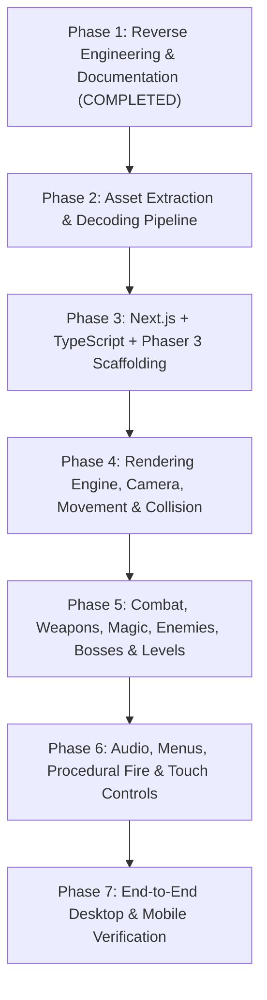

# God of War: Betrayal (2007 J2ME) — Web Migration & Implementation Plan

This document defines the step-by-step engineering plan for Phases 2–7 to convert the original J2ME *God of War: Betrayal* into a faithful, zero-backend Next.js + TypeScript + Phaser 3 web application while strictly preserving all original graphics, animations, proportions, timings, and gameplay mechanics.

---

## 1. Guiding Principles & Technical Constraints

1. **Read-Only Original Files**: All original files (`*.java`, `RP1`–`RP33`, `i.png`, `META-INF/`) remain untouched and read-only.
2. **100% Authentic Assets**: Every sprite, font glyph, tile, background stamp, animation frame, palette variant, and audio file is decoded directly from `RP1`–`RP33`—zero placeholder art or invented gameplay mechanics.
3. **Native Resolution & Aspect Ratio (`176 × 208`)**:
   - The Phaser 3 game canvas runs at a logical resolution of **`176 × 208` pixels** (`pixelArt: true`, `roundPixels: true`, `antialias: false`) matching the original Nokia S60 2nd Edition viewport (`e.hX = 176`, `e.hY = 208`).
   - On desktop and mobile browsers, CSS/Phaser `Scale.FIT` (with crisp `image-rendering: pixelated`) scales the `176 × 208` viewport cleanly to fill the screen while preserving the exact `11:13` aspect ratio.
4. **Tick & Delta-Time Fidelity (`e.aN`)**:
   - The Phaser scene update loop clamps `dt` (`e.aN`) to `[40ms, 100ms]` (`10`–`25` FPS logical simulation step) or runs a fixed-step accumulator so that animation durations (`K[]` in ms), root-motion displacements (`E[]`), gravity (`45 * aN / 100`), and timers behave identically to [`e.java`](file:///c:/Users/Intel/Downloads/GOW/god_of_war/e.java).
5. **Clean SSR-Safe Next.js Architecture**:
   - Phaser 3 is loaded exclusively on the client via Next.js `dynamic(() => import(...), { ssr: false })`.
   - Game engine logic lives in pure TypeScript modules under `web-game/src/game/`, completely decoupled from React/Next.js wrapper components (`web-game/src/components/`).

---

## 2. Phase-by-Phase Execution Plan



---

### Phase 2: Extract and Organize Original Game Assets

We will build a deterministic Python extraction script (`scripts/extract_assets.py`) that reads `RP1`–`RP33` and outputs both raw and web-ready decoded assets into:
* `resource-analysis/extracted/` (full raw + decoded inspection archive)
* `web-game/public/assets/` (optimized runtime bundle consumed by Phaser 3)

#### Deliverables in Phase 2:
1. **Base & Palette-Swapped PNG Atlases (`public/assets/images/`)**:
   - Extract all 28 indexed-color PNGs (`type = 253`), converting index `0` (`#FF00FF`) to full alpha transparency (`RGBA`).
   - Pre-generate all valid palette-swapped PNG variants (`type = 251`) by replacing the `PLTE` chunk + CRC32 exactly as [`a.c(int, byte[])`](file:///c:/Users/Intel/Downloads/GOW/god_of_war/a.java#L317-L350) does, saving each as `<pngId>_pal_<palId>.png` (and `<pngId>_default.png`).
2. **Sprite Slice & Bitmap Font JSONs (`public/assets/slices/`)**:
   - Decode all 34 `type = 254` tables (`a.b(int, byte[])`) into structured JSON (`slices.json`) containing `{ id, imageId, slices: [{ a, b, u, v, w, h, e, f, w2, h2 }] }`.
   - Decode the 3 Bitmap Fonts (`1031`, `1032`, `1033`) with delta-decoded UTF-16 codepoints (`c.e`), glyph metrics, baseline, and kerning into `fonts.json`.
3. **Hierarchical Animation Banks (`public/assets/animations/`)**:
   - Decode all 25 `type = 247` animation banks (`a.g(int)`) into JSON (`anim_<id>.json`), preserving:
     - Animation sequences (`loopCount`, `keyframes[]`)
     - Keyframes (`compFrameIdx`, `durationMs`, `priority`, `interpMode`, `dx`, `dy`)
     - Composite frames (`parts: [{ sliceIdx, offsetX, offsetY, flipFlags }]`, `boxes: [{ x1, y1, x2, y2, flags }]`)
4. **Decoded Level JSONs (`public/assets/levels/`)**:
   - Decode all 11 `type = 245` level bitstreams (`9216`, `9217`, `19456`–`27648`) into `level_<id>.json`, containing:
     - Level metadata (`widthTiles`, `heightTiles`, `widthPx`, `heightPx`, `introStringId`, `hy`, `dE`, `dF`, `maxOrbs`, `paletteVariant`)
     - 2D tile visual grid (`jb[]`) and pre-stamped 16-bit tile collision grid (`je[]`, with Groups `20`–`36` applied both as raw groups and pre-computed flags)
     - All entity spawn lists for Groups `0`–`19` (stamps, enemies, chests, push blocks, Kratos spawn, platforms, beams, camera zones, exits, checkpoints, wave spawners, dialogue triggers, flame traps, doors/gates, switches, ropes, ziplines, pendulums, torches).
5. **Localization & Menu Tables (`public/assets/data/`)**:
   - Extract all 6 language string tables (`10240`, `12288`, `29696`, `30720`, `32768`, `33792`) into `strings_<lang>.json`.
   - Extract Menu Table `1028` (`menu_table.json`) and Fire Palette `1053` (`fire_palette.json`).
6. **Audio Assets (`public/assets/audio/`)**:
   - Extract all 10 RIFF WAVE files (`1054`–`1062`, `1064`) as standard `.wav` files.
   - Extract MIDI file `1063` as `1063.mid` and also render/synthesize a Web Audio instrument bank so the title theme plays reliably across all desktop and mobile browsers without external soundfont dependencies.

---

### Phase 3: Create the Next.js + Phaser 3 Project (`web-game/`)

#### Proposed Directory Structure:
```text
web-game/
├── package.json
├── tsconfig.json
├── next.config.ts
├── public/
│   └── assets/                  # Extracted PNGs, JSONs, WAVs, MIDI from Phase 2
└── src/
    ├── app/
    │   ├── layout.tsx           # Viewport meta, retro styling
    │   ├── page.tsx             # Client host mounting GameShell + Virtual Keypad
    │   └── globals.css          # Crisp pixel-art canvas & mobile touch layout
    ├── components/
    │   ├── GameCanvas.tsx       # Dynamic SSR-disabled Phaser 3 canvas mount
    │   ├── VirtualControls.tsx  # Responsive mobile D-pad, Action, Softkeys, Weapon/PowerUp buttons
    │   └── ControlBar.tsx       # Optional desktop keybinding legend & audio/scale toggles
    └── game/
        ├── config.ts            # Phaser.Types.Core.GameConfig (176x208, Canvas/WebGL)
        ├── constants.ts         # Chapter tables (bJ, bK), physics constants, bitmasks
        ├── types/               # TypeScript interfaces for Slices, AnimBanks, Levels, Entities
        ├── systems/
        │   ├── AssetRegistry.ts # Loads & indexes slices, palettes, anim banks, strings
        │   ├── AnimPlayer.ts    # Exact port of a.java composite sprite + root-motion player
        │   ├── BitmapFont.ts    # Exact port of a.java binary-searched bitmap font renderer
        │   ├── InputManager.ts  # Unified J2ME key bitmask (iX, iZ, jb, jc) for Keyboard + Touch
        │   ├── AudioManager.ts  # Web Audio API WAV + MIDI synth player (1054..1064)
        │   └── SaveManager.ts   # Exact port of 76-byte RMS state in localStorage
        ├── entities/
        │   ├── Kratos.ts        # 43-state player FSM, movement, ledges, ropes, blocks, combat
        │   ├── EnemyManager.ts  # 16-slot enemy pool, AI states, wave spawners, QTE prompts
        │   ├── Bosses.ts        # Argos, Cerberus, Dead Rider, and Ceryx specialized behaviors
        │   └── LevelObjects.ts  # Doors, switches, push-blocks, platforms, beams, traps, chests, orbs
        └── scenes/
            ├── BootScene.ts     # Preloads RP1/RP8 core UI, fonts, splash, audio
            ├── SplashScene.ts   # Audio prompt ("Lord Kratos, do you wish to enable audio?") & logos
            ├── MenuScene.ts     # Procedural fire (1053), MenuFSM (1028), Help, About, Chapters
            └── PlayScene.ts     # Main gameplay loop, level loader, tilemap, HUD, Power-Up & Pause
```

---

### Phase 4: Rendering Engine, Camera, Player Movement, Animation & Collision

1. **Composite Sprite & Root-Motion Renderer (`AnimPlayer.ts`)**:
   - Implement [`a.b(Graphics, int, int, int)`](file:///c:/Users/Intel/Downloads/GOW/god_of_war/a.java#L839-L896) using Phaser `RenderTexture` / `Graphics` / `Image` blitting:
     - Iterates over composite parts `H[partStart .. partEnd]`, applying slice offsets `(a, b, e, f)` and horizontal/vertical flips (`0..3`) identically to [`c.a`](file:///c:/Users/Intel/Downloads/GOW/god_of_war/c.java#L41-L78).
     - Computes root-motion deltas `(dx, dy)` per tick using both step (`interp == 0`) and linear (`interp == 1`) interpolation modes (`a.java` lines 800–835).
2. **Layered Level Renderer (`PlayScene.ts`)**:
   - **Layer 0**: Distant sky/horizon parallax strip (`2056` / `2049`) when `hy == true`.
   - **Layer 1**: `16×16` base tilemap (`jb[]` from `2054`) + baked background stamps (`Group 0` where `isFg == false`) + persistent enemy corpse stamps (`e.r(int)`).
   - **Layer 2**: Interactive props (doors, chests, switches, push-blocks, moving/crumbling platforms, balance beams, ropes, ziplines).
   - **Layer 3**: Enemies, Kratos, blade plumes (`5124`), magic VFX (`5125`), blood/debris particles (`7169`), and orbs (`5123`).
   - **Layer 4**: Foreground stamps (`Group 0` where `isFg == true`) and foreground torches (`Group 19`).
   - **Layer 5**: HUD (`1037` Blade Emblem, green HP bar, blue Magic bar, weapon/magic icon `1035`, Red Orb counter, Hit counter, QTE directional prompt `1034`, dialogue box).
3. **Camera System**:
   - Implement exact look-ahead tracking (`bV, bW`), dynamic zone locking (`Group 8` triggers), boss/wave combat arena locks, and screen shake (`bY`).
4. **15-Flag Tile Collision & Kratos Locomotion (`Kratos.ts`)**:
   - Port the `16×16` tile collision probes (`e.c`, `e.d`, `e.e`) for solid floors (`1`), one-way platforms (`2`), walls (`4`), ladders/climbables (`8`), and slopes/stairs (`16`–`32768`).
   - Implement all non-combat movement states: run, jump, double jump, ledge grab/climb/drop, wall/ceiling climb, balance beam walk & rebalance, grapple rope swing (`Group 16`), zipline slide (`Group 17`), and box/statue push/kick/pull (`Group 3`).

---

### Phase 5: Combat, Enemies, Bosses, Health, Orbs & Level Progression

1. **Hitbox / Hurtbox Combat Engine**:
   - Extract world-space AABBs from active composite frames (`I[]` and `J[]` in `type = 247`).
   - Implement Kratos's **Athena's Blades** ground/air combo chains, **Blade of Artemis** heavy combos, **Medusa's Gaze** freeze beam (`ck`), and **Army of Hades** homing souls (`cj`).
   - Implement the **Power-Up Menu (`#` key)**: spending Red Orbs (`cp`) against cost table `cu` (`550`–`4500`) to upgrade weapons/magic (`cr[0..3]`), scaling damage and unlocking extended combos.
2. **Enemy AI & Wave Spawners (`EnemyManager.ts`)**:
   - Implement the 16-slot enemy pool (`eW = 16`), wave spawners (`Group 11`), soul-barrier doors (`Group 14`), and AI states for Soldiers, Undead Legionnaires, Archers/Bombers, Minotaurs, and Gorgons.
   - Implement **QTE Context-Sensitive Finishers**: when an enemy enters the weakened state (`ff`), display the spinning Arrow icon (`1034`), allow grab (`DOWN / 8`), slow game speed by `50%` (`aN >>= 1`), and validate directional/attack key sequences (`cE[cF]`) to trigger decapitation/cleave finishers and bonus orb drops.
3. **Boss Encounters (`Bosses.ts`)**:
   - **Argos** (Chapters 1, 3, 5): Multi-stage giant encounters + QTE finisher + sewer trap cutscene.
   - **Dead Rider** (Chapters 2, 6): Pursuing assassin encounters.
   - **Cerberus** (Chapters 6, 7, 8): 3-headed hound attacks, multi-phase health gates, and QTE sequences.
   - **Ceryx** (Chapter 10): Messenger of Olympus final boss phases and ending cutscene.
4. **Chests, Collectibles & Cutscene Scripting**:
   - Implement Red, Green, Blue, and Gold/Alternate (`Gorgon Eye` / `Phoenix Feather`) chests (`Group 2`) with hold-`DOWN` opening progress bar (`cn`).
   - Implement physics-bouncing Health, Magic, and Red Orbs that home in on Kratos (`fT[]`).
   - Port the dialogue & cutscene trigger interpreter (`Group 12`, `@`, `^0..^7`, `*`, `!`).

---

### Phase 6: Audio, Menus, Procedural Fire & Controls

1. **Audio System (`AudioManager.ts`)**:
   - Decode and play `1063` (MIDI title music), `1064` (level start/chest stinger), and `1062` (QTE/boss kill fanfare) exactly where `d.a(...)` is called.
   - Additionally wire an optional **"Enhanced Original SFX"** toggle (enabled by default) that triggers the 8 original recoverable WAV sound effects (`1054`–`1061` in `RP1`: blade slashes, impacts, grunts, orb pickup, menu ticks) on their corresponding combat/UI events!
2. **Menus & Procedural Fire (`MenuScene.ts`)**:
   - Port the `176 × 64` cellular-automata fire simulation (`e.C()`) using palette `1053` (`iD[256]`).
   - Port the 32-state menu state machine (`1028` / `iM[32]`), including Language Selection (`6` languages), Chapter Select, Arena Mode (`9216`), Help (`114`), About (`115`), Options, and Clear Save.
3. **Persistence (`SaveManager.ts`)**:
   - Port the 76-byte RMS save record (`iu[76]`) to `window.localStorage` (`"GodOfWar_RMS"`), preserving unlocked chapters, upgrades, orbs, max HP/Magic, and Arena high score.
4. **Desktop Keyboard & Mobile Touchscreen Controls (`InputManager.ts` & `VirtualControls.tsx`)**:
   - **Keyboard**:
     - `Arrow Keys` / `WASD` / `Numpad 2,4,6,8`: Directional input (`UP`, `DOWN`, `LEFT`, `RIGHT`)
     - `Space` / `Enter` / `Z` / `J` / `Numpad 5`: Attack / Confirm (`FIRE`)
     - `Q` / `Tab` / `Numpad *`: Cycle Weapon / Magic (`STAR` / Left Soft Key)
     - `E` / `U` / `Numpad #`: Power-Up Menu (`POUND`)
     - `Escape` / `P`: Pause Menu (Right Soft Key)
   - **Mobile Touch Controls**:
     - Responsive on-screen virtual D-Pad + Attack (`5`), Jump (`2`), Grab/Interact/Block (`8`), Weapon/Magic Swap (`*`), Power-Up (`#`), and Left/Right Softkeys positioned ergonomically around the `176 × 208` viewport in portrait and landscape orientations.

---

### Phase 7: Verification & Cross-Browser Testing

1. **Automated Asset & Level Integrity Tests**:
   - Verify all 28 PNGs, 56 palettes, 34 slice tables, 25 animation banks, 11 levels, 6 string tables, and 11 audio files load without error.
2. **Gameplay Verification Matrix**:
   - Verify Splash → Audio Prompt → Main Menu (with procedural fire & MIDI music) → Chapter 1 ("For Sparta") intro banner → Gameplay.
   - Verify Kratos movement, double jump, combat combos, QTE finisher, chest opening, orb homing, Power-Up menu (`#`), weapon/magic switching (`*`), and checkpoint saving.
   - Verify all 10 campaign chapters (`9217`..`27648`) and Arena Mode (`9216`).
   - Verify responsive layout and touch controls on mobile viewports (`375×667`, `390×844`) and desktop viewports (`1280×800`, `1920×1080`).
